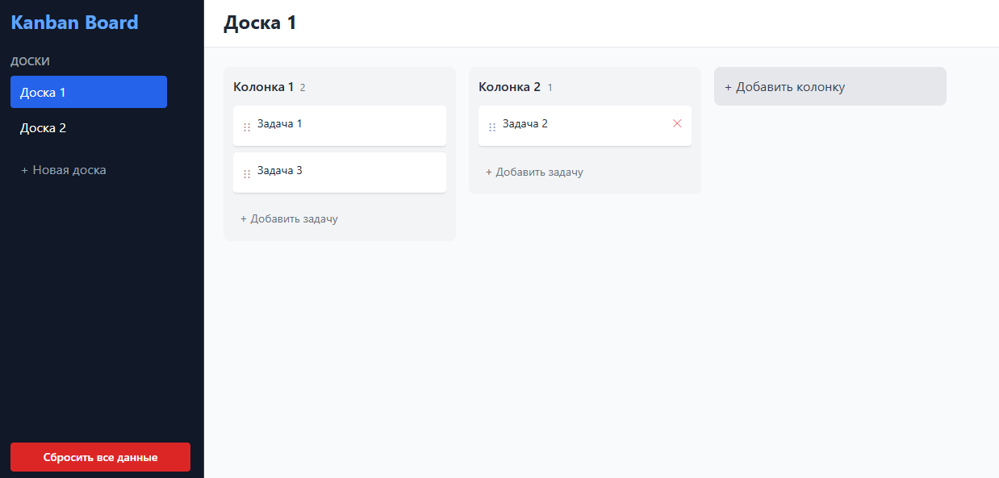

# Kanban Board

Простая и удобная Kanban-доска для управления задачами. Создавайте доски, добавляйте колонки и задачи, перетаскивайте карточки между колонками - всё работает прямо в браузере с сохранением данных.

🚀 **[Посмотреть Живой Деплой]()**

---

## 📸 Скриншоты интерфейса



---

## 🛠️ Технологический Стек


*   **React + TypeScript** - основа приложения
*   **Vite** - сборщик проекта
*   **Tailwind CSS** - стилизация
*   **Zustand** - управление состоянием
*   **@dnd-kit** - drag-and-drop функционал


---

## ✨ Возможности

1. 📋 Несколько досок — создавай и переключайся между разными проектами
2. ➕ Колонки — добавляй, переименовывай и удаляй колонки (например: "To Do", "In Progress", "Done")
3. 📝 Задачи — создавай, редактируй и удаляй задачи внутри колонок
4. 🖱️ Drag-and-Drop — перетаскивай задачи между колонками и меняй их порядок
5. 💾 Автосохранение — все данные сохраняются в браузере (localStorage)
6. 🗑️ Сброс данных — кнопка для полной очистки всех данных

---

## 🚀 Локальное Развертывание

Вы можете запустить проект локально:

1. Клонировать репозиторий:
   ```bash
   git clone https://github.com
   ```
2. Перейти в папку проекта:
   ```bash
    cd Сanban-board-2
   ```
3. Установить зависимости:
   ```bash
   npm install
   ```
4. Запустить сервер разработки (Turbopack):
   ```bash
   npm run dev
   ```
5. Открыть в браузере: [http://localhost:3000](http://localhost:3000), или [http://localhost:5173](http://localhost:5173)
